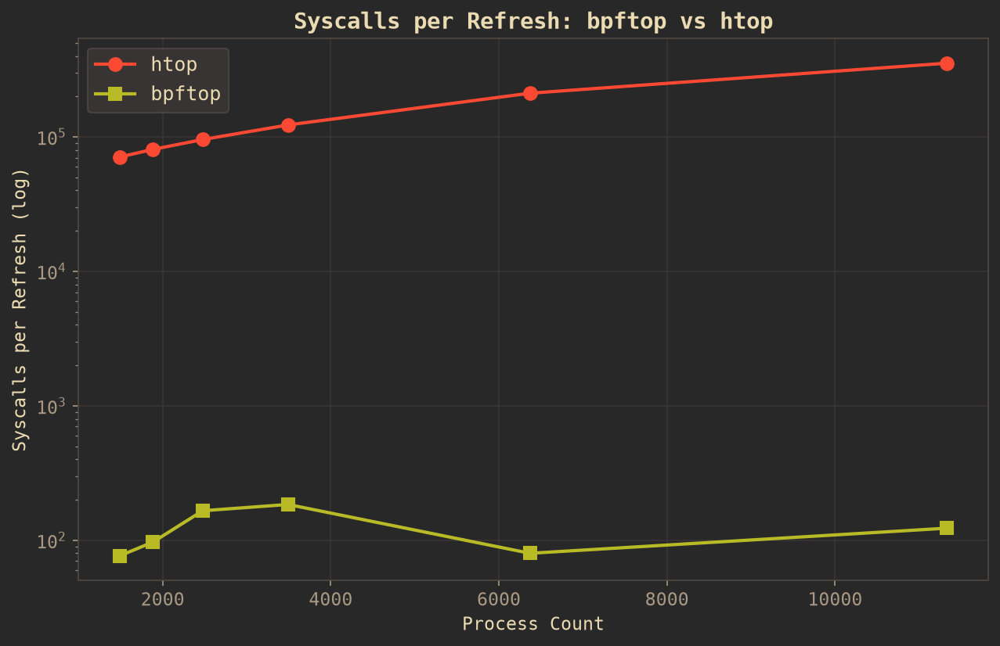
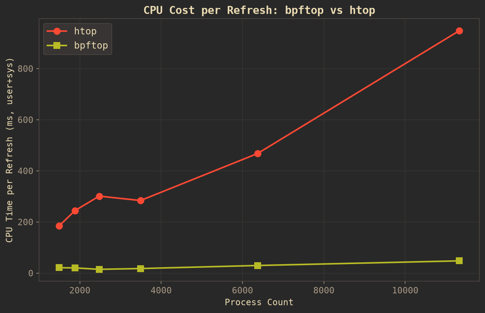
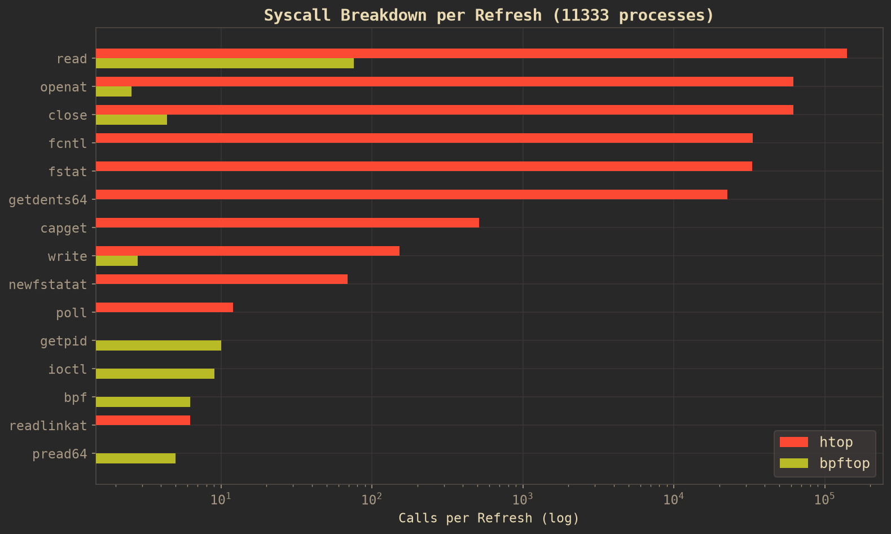

# bpftop

An htop-style process monitor built on eBPF.

bpftop walks the kernel task list with a BPF iterator instead of reading `/proc/<pid>/*` for every process. htop does about four file reads per process on every refresh, so its cost grows linearly with the number of processes; on a machine with many PIDs it becomes one of the more expensive things running. Other monitors such as btm and btop work the same way, as far as I know.

bpftop does one iterator walk plus one read each of four `/proc` files per refresh. That's around 100 syscalls per refresh at 1.5k or 11k processes, where htop makes 70k to 350k (see [Performance](#performance)).

Here's a (somewhat dated) demo.


# Disclaimer

I worked closely with Claude Code while building this. Claude has touched many parts of this codebase.

# Features

- Per-process data is collected in the kernel, so refresh cost barely grows with process count
- Container aware (Docker and Podman), shown by container name
- Shows which systemd unit (`.service`, `.slice`, `.scope`) owns a process, which helps when there are 15 processes named `python3`
- Per-process network I/O via fexit hooks on TCP/UDP (IPv4 and IPv6) send/recv, with a kprobe fallback for older kernels (`N` to toggle). This also happens in BPF, with no extra syscalls
- Per-process disk I/O: storage read/write rates and IOPS (read+write syscalls/s) from the kernel's I/O accounting, collected in the same BPF walk (`D` to toggle)
- Threads view (`H`), with per-thread state and CPU
- NVIDIA GPU usage per process (VRAM and utilization)
- cgroup v2 freeze/thaw: freeze whole services or containers atomically (`f`); see below
- Vim keybindings, folding, visual mode, and yank to clipboard (works in tmux)
- Statically linked musl binaries built in CI, which run on any Linux machine
- Works on both x86_64 and aarch64
- zram aware: memory usage accounts for zram, which htop doesn't (its memory bar and number disagree when zram is in use)
- Otherwise aims for feature parity with htop

# Freezing processes

Say a process keeps allocating memory and you're seconds away from the OOM killer. You've found the culprit, but it's been running for half an hour and you don't want to kill it. htop doesn't give you a good option, and if there are a lot of PIDs it's slow to respond anyway.

Suspending with SIGTSTP/SIGCONT isn't a clean alternative. The process and its parent can see those signals (SIGCHLD), handlers can ignore them, and children forked around the same time can miss the signal and keep running, or stall waiting on a stopped parent.

cgroup v2 has a better mechanism. Writing to `cgroup.freeze` stops scheduling everything in the cgroup atomically. The processes aren't notified, new forks start frozen, and only someone with write access to cgroupfs can thaw them. The one side effect is that wall-clock time keeps moving, so a frozen process sees a jump when it resumes.

In bpftop, `f` freezes the selected process's cgroup, `u` thaws it after a confirmation, and `U` thaws it immediately. Frozen processes are marked in the table.

# How to install

There's a nix flake with two outputs: dynamically linked and fully static musl binary. Statically linked is built and hosted on CI.

## NixOS

```nix
# flake.nix
{
  inputs.bpftop.url = "github:DieracDelta/bpftop";

  outputs = { self, nixpkgs, bpftop, ... }: {
    nixosConfigurations.myhost = nixpkgs.lib.nixosSystem {
      modules = [
        bpftop.nixosModules.default
        { programs.bpftop.enable = true; }
      ];
    };
  };
}
```

The module sets up capabilities (`cap_bpf`, `cap_perfmon`, `cap_sys_resource`, `cap_dac_override`, `cap_sys_admin`) so it works without sudo. The wrapped binary is at `/run/wrappers/bin/bpftop`.

## Non-NixOS with Nix

```bash
nix build github:DieracDelta/bpftop
sudo ./result/bin/bpftop

# or static (no runtime deps, copy it wherever)
nix build github:DieracDelta/bpftop#static
sudo ./result/bin/bpftop
```

## Non-Nix Linux

You need stable rust, clang (any recent version with the BPF target), and the libbpf headers (`libbpf-dev` / `libbpf-devel`).

```bash
# eBPF object first (finds the libbpf headers via pkg-config, or set LIBBPF_INCLUDE)
cargo xtask build-ebpf

# userspace binary
cargo build --release --bin bpftop
sudo ./target/release/bpftop
```

## Avoiding sudo

```bash
# core functionality
sudo setcap cap_bpf,cap_perfmon,cap_sys_resource=eip ./target/release/bpftop

# extra capabilities needed for cgroup freeze/thaw
sudo setcap cap_bpf,cap_perfmon,cap_sys_resource,cap_dac_override,cap_sys_admin=eip ./target/release/bpftop
```

# Usage

```bash
bpftop                     # default 1s refresh
bpftop -d 500              # 500ms refresh rate
bpftop -t                  # start in tree view
bpftop -u jrestivo         # filter by user
```

# Development

```bash
nix develop
cargo xtask run --release        # builds the eBPF object + bpftop, runs it with sudo
```

`nix build .#checks.x86_64-linux.bench-vm` runs bpftop as root in a NixOS VM against a synthetic workload, checks the collected data (cmdlines, CPU%, users, network bytes, freeze state) and records syscall counts per refresh. It's slow without KVM.

# Build details

We have a two-phase build. The kernel-facing eBPF program in `bpftop-ebpf-c/` is plain C compiled with clang as a CO-RE object, then the userspace binary embeds it at compile time via `include_bytes_aligned!`. Kernel struct fields (`task_struct`, `mm_struct`, `sock`, etc.) are relocated by Aya at load time from the running kernel's BTF, so the binary is not tied to a single kernel's byte offsets. `vmlinux_min.h` declares only the fields we read.

Network stats (NET/s, NET TOT) are cumulative since bpftop was started, not since process start. There's no kernel-level per-process network accounting, so we hook tcp/udp send/recv: fexit (BPF trampolines, 5.17+) where the kernel supports it, kprobes otherwise. `BPFTOP_NET_PROBES=kprobe` forces the fallback. A daemon that runs at boot would give lifetime stats, but that's a different tool.

# Tested on

Two NixOS machines — one aarch64-linux, one x86_64-linux.

# Acknowledgements

htop inspired this.

[psc](https://github.com/dpc/psc) pointed me in this direction. I didn't realize BPF was this far along until I saw that project.

# Performance

bpftop does one BPF iterator walk + one read of each of 4 `/proc` files per refresh. The per-process extras (cmdlines, network bytes, disk I/O, cgroup freeze state) are joined in-kernel by the iterator and usernames are cached. htop does ~4 file reads per process. And so, syscall count scales linearly with process count for htop, but stays flat for bpftop.

Measured on a Ryzen 9 5950X (32 threads), Linux 7.2.8, with htop 3.5.3. Both tools ran as their full TUI in the same 200x50 terminal, refreshing every 100ms with default configs, against N extra `sleep` processes. Numbers are per refresh (collecting + drawing), CPU is user+sys, median of 5:

| Processes | htop syscalls | bpftop syscalls | htop CPU ms | bpftop CPU ms | bpftop is |
|---:|---:|---:|---:|---:|---:|
| 1,487 | 70,887 | 76 | 184.1 | 20.8 | 8.8x cheaper |
| 1,883 | 80,744 | 97 | 244.5 | 20.1 | 12.2x cheaper |
| 2,476 | 95,574 | 166 | 300.8 | 14.5 | 20.8x cheaper |
| 3,491 | 122,752 | 184 | 283.6 | 17.5 | 16.2x cheaper |
| 6,371 | 211,439 | 80 | 467.6 | 29.5 | 15.9x cheaper |
| 11,333 | 353,711 | 123 | 948.3 | 47.6 | 19.9x cheaper |

At 11k processes htop needs ~0.95s of CPU per refresh, so it can't keep up with a 100ms refresh rate. bpftop's CPU still grows with process count (the kernel walks every task, and the UI handles every row), just much more slowly. Its syscalls wobble between ~75 and ~185: the BPF iterator hands back output in 32 KB `read`s (31 of them at 1.5k processes, 76 at 11k), and the 2.5k/3.5k runs include a cgroupfs re-walk because something on the machine created a cgroup mid-run. bpftop's numbers include NVIDIA GPU sampling (~3ms per refresh here), which htop doesn't do.







## Reproducing the benchmarks

```bash
nix build .#bench-run -o result-bench-run
sudo ./result-bench-run/bin/bpftop-bench-run   # SCALES="100 1000" K=20 REPS=5 to override
nix develop -c python3 bench/plot.py           # charts + the table above
```

Each tool runs once for 1 refresh and once for 1+K refreshes (`-n`); the difference divided by K is the per-refresh cost, so startup (BPF load and cmdline seeding for bpftop) cancels out. `strace -c` counts syscalls; CPU time is user+sys from `wait4`. Results land in `bench/results/`. See `bench/run.sh` for details.
